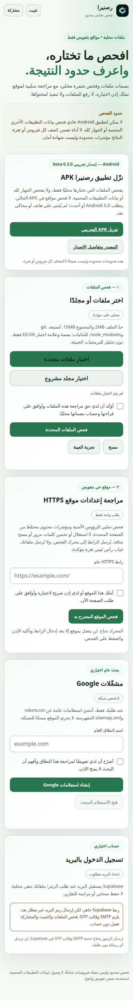

# رصنيرا — Rasnira 0.3.0

إصدار تجريبي 0.3.0-beta: PWA عربي RTL، وخادم اختياري لمراجعة موقع مصرح به، وAPK تجريبي لفحص الملفات المحددة. نُشرت هذه النسخة بموافقة المستخدم. لم يُفحص موقع حي أثناء التطوير.

[الموقع العام المؤقت](https://rasnira.mildly-city.workers.dev) — [تنزيل APK التجريبي](https://github.com/Hassadwegdw/rasnira/releases/download/v0.3.0-beta/rasnira-0.3.0-beta.apk) — [الإصدار والمصدر المعتمد](https://github.com/Hassadwegdw/rasnira/releases/tag/v0.3.0-beta).



## الوظائف وحدودها

**الموقع:** فحص ساكن محدود للشفرة والأسرار، وبصمات SHA-256 وعلامة EICAR الاختبارية غير الضارة. لا تنفيذ ولا رفع للملفات. الثنائيات تحصل على بصمة وفحص علامة الاختبار فقط، لا تحليل فيروسات. الحد 2 MiB للملف و15 MiB للمجموعة.

**مراجعة المواقع:** عند تشغيل `server.py` تتاح مراجعة صفحة HTTPS عامة واحدة بعد تأكيد التفويض، للرؤوس الأمنية وخصائص الكوكيز ومراجع HTTP المحتملة. لا تتبع تحويلات أو استغلال أو مسح منافذ. غياب رأس ليس ثغرة مؤكدة. الاستضافة الثابتة وحدها لا تشغّل محرك Python، وتوضح الواجهة ذلك صراحةً.

**APK:** تطبيق Java أصلي دون إذن إنترنت، وليس غلافًا للموقع. يقرأ الملفات التي يحددها المستخدم عبر منتقي Android، ويحسب SHA-256 لكامل الملف ويحلل أول 2 MiB لأنماط محدودة وعلامة EICAR. الحد 20 MiB للملف و100 MiB للمجموعة. لا فحص مواقع أو تسجيل دخول أو تصدير في APK الحالي. النتائج داخل التطبيق. يتطلب Android 5.0+ ويستهدف SDK 35.

لا يصل تطبيق عادي لبيانات التطبيقات الأخرى المحمية أو يفحص الجهاز كله. لا توجد قاعدة توقيعات فيروسات أو CVE، ولا ضمان لكشف كل فيروس أو ثغرة. عدم وجود مؤشرات ليس شهادة أمان.

## إصلاحات قائمة الأخطاء

- استُبعدت `re.exec` و`regex.exec`، وأُضيف تتبع استيرادات `child_process` وأسمائها البديلة. تُحجب التعليقات والسلاسل البسيطة من قواعد التنفيذ؛ فحص الأسرار منفصل كي يحتفظ بكشف القيم الحقيقية داخل السلاسل والتعليقات. هذا ليس محلل AST كاملًا.
- دُعمت Dockerfile وMakefile والملفات بلا امتداد و`.env.*` و`.pem` و`.key` و`.npmrc` و`.pypirc` و`.properties.*`. يسجل التقرير غير المدعوم وأسبابه والتغطية الفعلية.
- حد السطر 5000 حرف مع عدد الأسطر المحدودة وتفاصيل أول 100 منها. سقف الماسح 500 نتيجة لكل استدعاء؛ الواجهة تحفظ حتى 1000 وتعرض أول 200 للحفاظ على الاستجابة. الأعداد المحجوبة معلنة.
- التحليل داخل module Web Worker مع تقدم «جارٍ فحص n من m». تتناوب القراءة والبصمات مع إطارات العرض. عند منع العامل تظهر رسالة فشل بدل تحليل متزامن ضخم.
- أُصلح تلوين خطأ النطاق، وأضيف «تغيير البريد» مع إيقاف مؤقت الإرسال، واستخدام حالة النجاح، وإضافة رابط التنزيل إلى DOM ثم إزالته.
- تُفك BOM لـUTF-16LE/BE، ولا تُعد ANSI ESC دليلًا ثنائيًا بذاتها؛ السبب الدقيق لتجاوز الثنائيات ظاهر.
- الألوان متغيرات CSS مع وضع فاتح حسب النظام. نسب تباين الشارات: medium ‏8.70:1، low ‏7.23:1، info ‏5.41:1.
- عامل الخدمة stale-while-revalidate للموارد المحلية، دون API أو non-GET أو المصادر الأخرى. تظهر النسخة المحدثة في زيارة لاحقة دون تبديل اسم الكاش لكل تعديل؛ لا تبديل فوري للتطبيق المفتوح.
- أيقونة maskable منفصلة مع هامش يقارب 10% وخلفية معتمة، واختصارات manifest لقسمي الملفات والموقع. screenshots اختيارية ولم تُضف صور نتائج مصطنعة.
- تُعطل أدوات التثبيت/المشاركة/الحافظة والتنزيل عند اكتشاف غيابها أو منعها، مع رسالة واضحة. فشل عامل الخدمة معلن. بعض قيود iframe عبر أصول مختلفة لا يمكن كشفها مسبقًا؛ افتح الصفحة في متصفح كامل.

لا تُضمّن مقتطفات الشفرة أو قيم الأسرار المكتشفة في التقارير. تُنقح الأنماط المعروفة في أسماء الملفات وقوائم الاستبعاد أيضًا. لا يمكن ضمان التعرف على كل معلومة حساسة مجهولة النمط في اسم ملف؛ راجع التقرير قبل مشاركته.

مكتبة Supabase المضمنة لم تتغير. مصادقة البريد اختيارية وغير مفعلة للإرسال حتى إعداد SMTP وقالب OTP واختبارهما. لا حفظ سحابي أو مزامنة تقارير.

## التشغيل والاختبار

لا توجد اعتمادات إنتاج خارجية جديدة للواجهة أو خادم Python.

```sh
npm test
python3 -m unittest discover -s tests -v
python3 server.py
```

افتح `http://127.0.0.1:8000`. لتغيير المنفذ: `PORT=8766 python3 server.py`.

الخادم محلي عمدًا، وليس إعداد إنتاج عامًا. يخدم `public` فقط. يثبت IP عام بعد DNS مع TLS SNI، ويرفض العناوين الخاصة وIP literals، ولا يتبع التحويلات. حد العينة 256 KiB وحد الطلبات خمسة بالدقيقة، مع Origin وHost محليين مطابقين وتفويض صريح.

اختبارات المتصفح تتطلب Playwright وChromium في بيئة التطوير وخادمًا على 8766:

```sh
python3 tests/ui_smoke.py
python3 tests/acceptance_ui.py
```

### نتائج التحقق

نجحت اختبارات الماسح الأصلية والجديدة دون حذف الاختبارات القديمة، و9 اختبارات ملفات/PWA، و11 اختبار Python دون اتصال بأهداف خارجية. نجح اختبار المتصفح للملفات والبصمات وEICAR وJSON والتفويض والمسح، وOTP محاكى دون بريد حقيقي.

اختبار 15 MiB اكتمل في 4.65 ثانية في هذه البيئة مع 147 نبضة واجهة و8 تحديثات تقدم؛ أكبر فجوة مرصودة 264 ms. هذه قياسات محلية وليست وعدًا بالأداء على كل هاتف.

Lighthouse 13.5.0 محليًا: الوصولية 100/100 والممارسات 100/100. لا يتضمن هذا الإصدار فئة PWA القديمة؛ لا ندعي شهادة اجتياز منفصلة لكل شروط التثبيت. اختُبر manifest وعامل الخدمة باختبارات المشروع، ولم يُختبر تثبيت هاتف فعلي.

APK: نجح البناء واختبار محرك Java المستقل والتحقق من التوقيع v1/v2/v3 وبيانات الحزمة. لم يُشغّل على Android أو محاكي؛ الإصدار تجريبي. تفاصيل إعادة البناء في `android/BUILD-NOTES.md`.

## النشر

مجلد أصول الموقع هو `public` وحده. لا تنشر المشروع كاملًا أو Android أو مفاتيح التوقيع أو الاختبارات. تشغيل فحص المواقع على استضافة عامة يتطلب خدمة خلفية مؤمنة؛ Python لا يعمل على استضافة أصول ثابتة. النشر الحالي مصرح به. الاستضافة المؤقتة محدودة الصلاحية؛ لا تُحفظ روابط المطالبة الخاصة أو بيانات اعتماد النشر في المستودع.

مفتاح توقيع الاختبار محفوظ محليًا داخل `android/.private` ومستبعد من حزمة المصدر وGit. لا تستخدمه للإنتاج؛ احتفظ به محليًا لتوقيع تحديثات اختبار متوافقة.

[حدود وصول Android إلى الملفات](https://developer.android.com/training/data-storage/shared/documents-files) — [منتقي المستندات الرسمي](https://developer.android.com/guide/topics/providers/document-provider).
