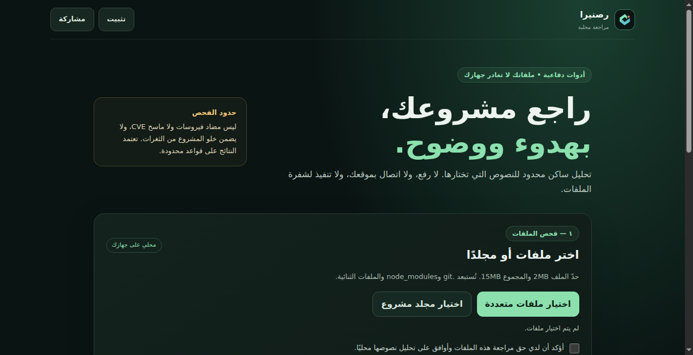

# رصنيرا — Rasnira


Arabic local-first static code-review PWA. A limited defensive review tool, not a comprehensive vulnerability scanner.

[جرّب الموقع — معاينة عامة مؤقتة](https://rasnira.sumptuous-mare.workers.dev)



موقع عربي وتطبيق ويب قابل للتثبيت (PWA) لمراجعة الملفات النصية محليًا، ضمن ملكية المستخدم أو إذن صريح.

## ما يعمل

- اختيار ملفات أو مجلد مشروع وتحليلها داخل المتصفح دون رفعها أو تنفيذها.
- مؤشرات ساكنة لأنماط مثل التنفيذ الديناميكي، إدراج HTML غير الآمن، أوامر النظام، تعطيل TLS، أسرار مضمنة، وسياسات CORS واسعة.
- نتائج مع اسم الملف والسطر والتفسير والإصلاح المقترح؛ حجب الأدلة التي تحتوي أنماط أسرار معروفة.
- تصدير JSON، نسخ التقرير ومسح بياناته من الصفحة.
- استعلامات Google عامة اختيارية لا تفتح إلا بطلب المستخدم.
- تثبيت PWA ومشاركة الرابط؛ يعمل الفحص المحلي دون حساب، ويمكن تشغيل الواجهة دون اتصال بعد أول تحميل ناجح.

## حالة الحسابات

تم ربط إعداد الواجهة العام بمشروع Supabase المخصص. لا يوجد مفتاح سري أو service_role داخل الموقع. تدفق إرسال/التحقق من OTP موجود في الكود، لكنه **غير مفعّل للإرسال العام** حتى إعداد SMTP مخصص وقالب بريد يحوي `{{ .Token }}` واختبار الإرسال والتحقق. المتغير `EMAIL_OTP_READY` في `config.js` يبقى `false` إلى حين ذلك. لا يُرسل التطبيق بريدًا تلقائيًا.

إعداد البريد يتم داخل Supabase Auth. لا تضع بيانات SMTP أو المفاتيح السرية في ملفات الموقع العامة، ولا تغيّر العلم إلى `true` قبل إكمال الخدمة واختبارها. الحساب لا يعني حفظ التقارير أو مزامنتها؛ التقارير محلية فقط.

## الحدود

هذا محلل قواعد ساكنة محدود، لا ماسح شامل لكل الثغرات، ولا مضاد فيروسات، ولا خدمة CVE أو مراجعة تدفق بيانات. النتائج مؤشرات تحتاج مراجعة وقد تكون إيجابية أو سلبية كاذبة. عدم ظهور نتيجة ليس شهادة أمان. لا ينفّذ فحص شبكة أو استغلالًا أو مسحًا لموقع حي. الدليل في التقرير قد يتضمن مقتطف شفرة؛ راجع التقرير قبل مشاركته، فإخفاء الأسرار يعتمد على الأنماط المعروفة فقط.

حد الملف 2 MiB والمجموع 15 MiB. يُستبعد `node_modules` و`.git` والملفات الثنائية. اختيار المجلدات يختلف حسب المتصفح والهاتف؛ اختيار ملفات متعددة هو البديل. التثبيت PWA عبر متصفح يدعم الميزة؛ لا يتضمن المستودع APK/IPA أو حزمة متجر أصلية.

## التشغيل والاختبار

يتطلب Node.js حديثًا للاختبار فقط، وPython لمعاينة الملفات محليًا:

```sh
npm test
python3 -m http.server 8080
```

افتح `http://localhost:8080`. يلزم HTTPS أو localhost لعامل الخدمة والتثبيت وميزات الحافظة. للنشر، جهّز مجلد أصول يحتوي ملفات الواجهة فقط كما في المثال أدناه. لا تضمّن الاختبارات أو ملفات البيئة.

المكتبة `supabase-client.js` تضم عميل Supabase JS 2.57.4 مع إشعارات تراخيصه. المفاتيح القابلة للنشر عامة، لكنها ليست تفويضًا لقراءة بيانات مستخدم آخر؛ فعّل RLS وسياسات مناسبة قبل إضافة أي جداول أو تخزين بيانات.

## الهوية

الاسم مبتكر لهذا المشروع. لم يظهر تطابق مباشر له في البحث العام بالتهجئتين «رصنيرا» وRasnira أو بحث مستودعات GitHub عند الإعداد. هذا فحص أولي لا حجز لعلامة تجارية ولا ضمان قانوني للتفرّد. الرمز البصري مولّد خصيصًا للمشروع وليس مأخوذًا من مكتبة شعارات جاهزة.

## مراجع إعداد الحسابات

- [Supabase: الدخول دون كلمة مرور وOTP](https://supabase.com/docs/guides/auth/auth-email-passwordless)
- [Supabase: إعداد SMTP وقيود البريد الافتراضي](https://supabase.com/docs/guides/auth/auth-smtp)
- [Supabase: الفرق بين المفاتيح العامة والسرية](https://supabase.com/docs/guides/getting-started/api-keys)

## تجهيز مجلد النشر

```sh
mkdir -p dist
cp index.html app.js styles.css scanner.js config.js supabase-client.js service-worker.js manifest.webmanifest icon-192.png icon-512.png dist/
```

انشر `dist` وحده؛ لا يحتوي ملفات المطالبة الخاصة أو بيانات SMTP أو مفاتيح سرية.
